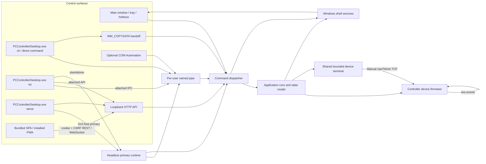

# Architecture

PCControllerDesktop is a single-user Windows controller. In attached operation the GUI
process owns the device connection and is the authoritative state coordinator;
every local control surface routes through the same dispatcher instead of
implementing device behavior independently. The terminal UI can also be launched
in explicit standalone mode, where it becomes a headless primary: it claims
the same per-user pipe before persisting configuration or opening the device
connection.

## Processes and entry points

`PCControllerDesktop.exe` is the only shipped executable and is linked as a Windows
console-subsystem PE so an invoking shell waits for CLI/TUI completion and
receives the real process exit code. On Windows 11 24H2, Windows Server 2025,
and later releases, a manifest console-allocation policy prevents automatic
console allocation when launched outside an existing console session without
changing those CUI shell semantics. On older supported releases, runtime
startup detaches only a console that the process owns exclusively; an inherited
or shared console is retained, though Explorer can still show a brief pre-main
flash. With no mode the process is the primary UI or a short-lived command
handoff client; it also hosts the opt-in
out-of-process COM local server. The primary instance is gated by the named
pipe, not by a timing-sensitive mutex.

`PCControllerDesktop.exe cli` is the controller-only surface. With no command it requests
status. It emits readable JSON-shaped output by default, strict JSON with
`--json`, and ANSI color only when the target is a suitable terminal and
`--no-color` was not supplied.

`PCControllerDesktop.exe tui` is the interactive application built on Bubble Tea, Lip
Gloss, Bubbles, and Huh. In attached mode it is a replaceable
presentation layer over named-pipe IPC or the authenticated loopback API; the
GUI remains the state/connection owner and the TUI polls its in-memory status.
In standalone mode the terminal process becomes the authoritative headless
primary. It owns the same named-pipe gate and command dispatcher, then creates
the normalized configuration, application core, HTTP/WebSocket client, native
state subscription, automation runner, and audible event effects without
starting any GUI, tray icon, or global hotkeys. Existing pipe clients can
control or quit that session exactly as they control the GUI primary.

`PCControllerDesktop.exe serve` uses the same headless primary runtime but makes the
embedded browser application its presentation layer. It creates no native
window or tray service. After winning named-pipe ownership it starts the
loopback HTTP/WebSocket API, embedded SPA handler, event-effects service, and
device core. API listener changes are serialized outside active request-handler
locks; configuration is broadcast before a graceful close/rebind. IPC quit or
console cancellation then joins HTTP, effects, automation, IPC, and core
workers in order.

The explicit CLI, TUI, and serve routes attach to the parent console and repair
missing standard handles at runtime while preserving redirected pipes/files.
Serve does not allocate a console when launched without one. All modes share
protocol, state, configuration, build metadata, and the same
architecture-matched Windows resource. Release builds are pure Go
(`CGO_ENABLED=0`).

The bundled Preact SPA uses a relative asset graph and hash routes, then is
embedded in the same Go executable and served beneath `/app/`. In relay mode
it authenticates with a short-lived HttpOnly, SameSite browser-session cookie;
mutating REST calls additionally carry the session's CSRF token. The long-lived
bearer token is never serialized into HTML, JavaScript, browser storage,
configuration responses for the UI, or the service worker. One tab owns the
application WebSocket through Web Locks when available, and a versioned
`BroadcastChannel` distributes ordered snapshot, configuration, diagnostic,
and message events to the other tabs.

Large cross-surface assets are not copied into the compiled Web distribution.
The native asset bundle, `/app/shared/sfx/*.wav`,
`/app/shared/icons/app.png`, and the static ZIP exporter all read the same
canonical `assets.Files` entries. The service worker knows their content
hashes, but the WAVs and 512-pixel product artwork occur only once in each
deliverable.

Raw device-terminal traffic uses a separate, same-origin, browser-session
WebSocket and never enters that application event stream or BroadcastChannel.
The core owns one manually opened TCP session, a bounded in-memory transcript,
and independent cursor reads for the TUI, HTTP/IPC clients, and browser tabs.
The static/direct browser build cannot open raw TCP itself; its terminal view
therefore requires a same-origin PCControllerDesktop coordinator.

The browser terminal asks xterm.js to use its WebGL renderer after the terminal
is attached to the document. If WebGL initialization fails or the browser
reports a lost graphics context, the addon is disposed and xterm's canvas
renderer continues with the same session and transcript. Browser rendering is
capability-owned by the browser and is independent from the native
`ui.render_backend` policy.

The UI-facing client contract has two implementations. The relay client uses
the authenticated same-origin Go API and its normalized event stream. The
direct client issues credential-free CORS-simple GET requests only to
`/device/get`, `/device/on`, and `/device/off`, selects a safe on/off action for
toggle from confirmed state, and connects to `/ws` with bounded reconnect.
Both normalize state/message events before they reach the store. Automatic
mode tries relay first and falls back to direct; an explicit selection never
silently changes transport. Broadcast channel and Web Lock names are derived
from transport plus target, so tabs for different devices cannot cross-talk.

Direct diagnostics accept exactly the six public, noncredential device endpoints
and share the plain-line/JSON/XML parser and redacted typed projection used by
the UI. The Go coordinator and direct/static browser client additionally poll
exact `/config/ap` and `/config/st` projection sources to obtain SSID and
network addressing. Their `pass` values are removed immediately, their raw
bodies are never cached, broadcast, or exposed, and neither path can be selected
through the public raw-diagnostics interface. Direct
configuration is browser-local and synchronized across tabs; native window,
hotkey, notification, automation, and integration controls are hidden. The
deterministic static ZIP is compiled direct-first, while the embedded build is
relay-first. Both builds come from the same source and use relative assets plus
hash routing.

Browser shortcut recording uses an authenticated, CSRF-protected 30-second
lease with heartbeat renewal. The first active lease suspends the shell's
`RegisterHotKey` bindings; the last release or expiry restores them. Completed
chords are probed on the window thread before configuration is committed.
Opaque per-recorder lease IDs, a bounded lease count, and expiry cleanup keep a
closed or crashed tab from leaving global shortcuts suspended.

Shared colors, surfaces, type, strokes, radii, spacing, and motion live in
`internal/design/tokens.json`. Go parses the same document used by Vite's
virtual CSS module, preventing the native and browser palettes from silently
drifting. The browser honors the shared `ui.theme`, reduced-motion, and forced
color preferences. Its glass treatment is browser composition within the
page; it does not claim to expose the desktop DWM backdrop.

The stable `ui.locale` preference (`auto`, `en`, or `fa`) is resolved by the
shared Go localization layer and carried through the normal configuration
event stream. Native GUI/dialog/tray/TUI surfaces and Web clients therefore
change language without process or page restart. Persian presentation mirrors
direction-sensitive geometry and shapes human-facing digits; protocol and
diagnostic values remain in isolated LTR runs. YekanBakh VF has one canonical
owner in `assets/fonts`: native code registers those bytes as a private Windows
font, the embedded host serves them under `/app/shared/fonts/`, and the static
export inserts the same bytes exactly once.

Win32 uses the VF's GDI named faces, `Yekan Bakh VF Regular` and
`Yekan Bakh VF Bold`. Requesting only `Yekan Bakh VF` silently selected Arial
on the verified Windows 11 host even though `AddFontMemResourceEx` succeeded.
`winfx.EnsurePersianFont` registers the canonical bytes once per process and
checks the physical face with `GetTextFaceW`; the process owns the registration
so independent SDK/modeless dialogs do not depend on a Shell's lifetime.
Older GDI can use the default face with synthesized bold when named faces are
unavailable, and registration/selection failure uses Segoe UI. No second font
asset, system installation, disk extraction or runtime dependency is needed.
Live dialog localization visits all tab pages and updates explicit heading
fonts as well as inherited body fonts, preserving point sizes and styles.
The vendored Walk tab layout maps full rectangles between native client
coordinate spaces so an RTL language switch cannot collapse a page to zero
width. Its native fixture checks selected-page bounds as well as font faces.

## Core and state propagation

The application core owns:

- the normalized configuration;
- the current `Snapshot`;
- the HTTP/WebSocket device client;
- command serialization;
- reconnect and polling lifecycle;
- event subscriptions.

On startup it creates one device client, starts the WebSocket listener when
enabled, and optionally starts HTTP polling. Commands update a pending marker,
perform the HTTP request, and merge the confirmed state. WebSocket snapshots
and connection status update the same model. Subscribers receive immutable
event values, so the UI, notifications, automation, and diagnostics all see a
consistent state.

## Firmware transport

HTTP operations are exact same-origin GETs. Redirects are not followed.
Response bodies are bounded to 1 MiB. The client sets a stable user agent,
disables caches, validates state responses, and treats non-2xx responses as
structured errors.

The WebSocket listener connects to `/ws`, sends exactly one text `get` after
each successful connection, and then passively consumes frames. The one-command
rule is intentional because the audited firmware leaks memory for each command.
Ping/pong keepalive, bounded reads, write deadlines, cancellation, and
exponential reconnect are handled below the UI layer.

See [Firmware protocol](firmware-protocol.md).

## `.local` resolution cache

HTTP and WebSocket use a shared one-entry resolution cache when the configured
hostname ends in `.local`:

1. The first connection resolves the hostname and prefers IPv4 when available.
2. Subsequent dials reuse that IP; routine operation does not continuously
   query mDNS/DNS.
3. A dial failure invalidates only the IP that failed.
4. An HTTP transport/read failure or unexpected WebSocket loss clears the
   cache.
5. The next attempt resolves the hostname again.

`.local` traffic bypasses configured HTTP and WebSocket proxies. Redirects are
disabled so an audited device route cannot escape to another host.

## Windows shell

The shell package owns the Walk window, its independently selectable
caption/frame policy, tray icon, popup menu, global hotkeys, painting,
SVG/APNG playback, notification manager, sound cues, settings, diagnostics,
and automation runner. The automatic border retains native edge resizing;
the explicit no-border mode removes the sizing frame. Walk remains the native
HWND, message-loop, focus, accessibility, and modal-control scaffold. The
visual surface is a separate adaptive premultiplied-alpha compositor. In
`auto` or `directx` mode, compatible systems dynamically initialize hardware
D3D11, DXGI, and DirectComposition and present PCControllerDesktop's own premultiplied
surface without a GPU-to-CPU desktop readback. The implementation binds those
Windows components directly from pure Go; it introduces no CGO dependency,
import library, or external DirectX redistributable. The retained
GDI/`UpdateLayeredWindow` presenter is the explicit `legacy` mode and the
automatic safety path when hardware initialization or presentation fails.
Both presenters supply the same SVG/APNG foreground, Fluent controls, reveal
lighting, elevation, and antialiased geometry.

The accelerated native path is intentionally hybrid. The existing,
regression-tested SVG/APNG, text, and Fluent-control renderer rasterizes the
app-owned scene into a premultiplied BGRA buffer; D3D11 uploads that buffer to
a retained flip-model swap chain, while DXGI, DirectComposition, and DWM own
buffering, presentation, opacity, synchronization, and final GPU composition.
This removes repeated HWND bitmap presentation and gives animation a
hardware-composited, vsynchronized final stage without claiming that every
glyph or vector primitive has been rewritten in Direct2D. Browser terminal
rendering independently prefers WebGL and falls back to its canvas renderer
after a context loss.

No main-window or tray visual is made from a desktop capture, snapshot, or
desktop readback. DWM/Accent draws the live material behind each ordinary host
window, while the foreground contains only PCControllerDesktop-owned pixels. Complete
transparent mode deliberately selects the per-pixel layered presenter: a
DirectComposition visual can blend alpha but cannot use that alpha as the
HWND's native hit-test mask. This preserves exact alpha-zero pointer
click-through. A removed, reset, hung, or otherwise failed graphics device
tears down the accelerated presenter and switches to the legacy path rather
than leaving an empty or frozen window.

Settings and diagnostics retain native controls. Their non-client frame uses
native dark mode and rounded corners, while the GDI client uses one
composition-safe Fluent material plus explicit dark/light tab and button
painting. The client is deliberately not extended into DWM glass: doing so
would give ordinary GDI child pixels ambiguous alpha and recreate black or
washed text fringes. UI callbacks enter the shared dispatcher. Non-UI
callbacks synchronize work onto the window thread.

Visual effects are capability-driven:

- Windows 11 system backdrops are preferred when supported.
- Acrylic/blur APIs provide best-effort fallbacks on supported Windows 10
  builds.
- `auto` prefers the D3D11/DXGI/DirectComposition presenter when its complete
  hardware stack is available; `directx` requests it explicitly.
- `legacy` and every accelerated initialization, presentation, or device-loss
  failure use the retained GDI/`UpdateLayeredWindow` presenter.
- solid rendering remains the final fallback.
- High Contrast or the user's disabled-transparency preference suppresses
  transparency.

Magnetic snap is implemented while handling the Win32 moving message. The
proposed window rectangle is compared with the monitor work area and nearby
edges using the current DPI-scaled threshold. Per-drag hysteresis retains a
chosen edge only inside a bounded release zone, so moving away always detaches
the window cleanly. The current physical Ctrl state is sampled for every
`WM_MOVING`: pressing Ctrl detaches without a jump and suspends acquisition,
while releasing it immediately re-enables snapping in the same drag session.

## Notifications and cues

The notification manager creates `ToastGeneric` XML with the embedded app
artwork and on/off activation actions. `auto` delivery attempts a toast and
falls back to the existing notification icon's native `NIF_INFO` balloon.
`toast` and `balloon` force one path.

Audio is a separate service with four semantic cues: `on`, `off`, `message`,
and `error`. Its default catalog is deterministic mono 44.1-kHz, 16-bit PCM
WAV, embedded once and played from memory by the native worker. A custom PCM
WAV is validated, named by the lowercase SHA-256 of its exact bytes, stored
once beside the active configuration, and atomically selected; the same custom
asset intentionally maps to all four cues. Configuration carries only the
source, ID, and display name, never file bytes or an arbitrary path.

State/message effects follow the `sound` and `initial_sync` policy but are
dispatched independently of visual notification delivery. Explicit
`audio.play` and validated firmware `beep:` requests remain audible. The GUI,
standalone TUI, and GUI-free Web host use the same manager and bounded playback
queue. In coordinator Web mode the Go owner plays once. In direct/static mode
the elected realtime browser tab uses Web Audio and a SHA-256-addressed
IndexedDB store; BroadcastChannel followers do not replay the event.

Remote message length, UTF-8, NUL, control characters, icon values, and beep
counts are validated before they reach the shell.

## Integration boundaries

All integrations use IPC protocol version 1 and the same method names:

- **Named pipe:** request/response, newline-delimited JSON, 1 MiB maximum,
  current-user SID-derived name, current-user plus SYSTEM ACL.
- **WM_COPYDATA:** acknowledgement-only command handoff, 64 KiB maximum, a
  magic payload tag, bounded send timeout, and window-property discovery.
- **Loopback HTTP:** explicit loopback address, bearer token, structured HTTP
  errors, strict route methods and bodies.
- **COM:** opt-in `HKCU\Software\Classes` local-server registration that proxies
  to the primary named pipe.

The TUI transport layer consumes these boundaries rather than bypassing them.
Named-pipe attach is restricted to the current user, API attach uses the token
from the protected configuration, and standalone mode talks only to the
configured device origin.

See [Commands and integrations](integration.md) for wire examples and the
complete command mapping.

## Data and failure behavior

The default user files are:

| Path | Purpose |
| --- | --- |
| `%APPDATA%\PCControllerDesktop\config.json` | Strict JSON configuration and local API secret |
| `%APPDATA%\PCControllerDesktop\sfx\<sha256>.wav` | Validated, content-addressed custom sound assets |
| `%APPDATA%\PCControllerDesktop\PCControllerDesktop.log` | Application and automation log |
| `%APPDATA%\PCControllerDesktop\PCControllerDesktop.log.previous` | One rotated log generation |
| `%APPDATA%\PCControllerDesktop\toast-icon.png` | Private cached copy of embedded toast artwork |

Configuration saves use a same-directory temporary file, flush, atomic
replacement, and a current-user-only Windows ACL. The log rotates after
approximately 2 MiB. Automation output is bounded to 64 KiB per run.
