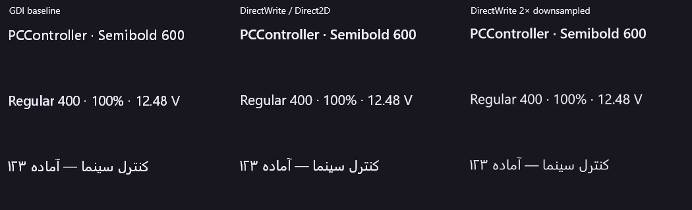
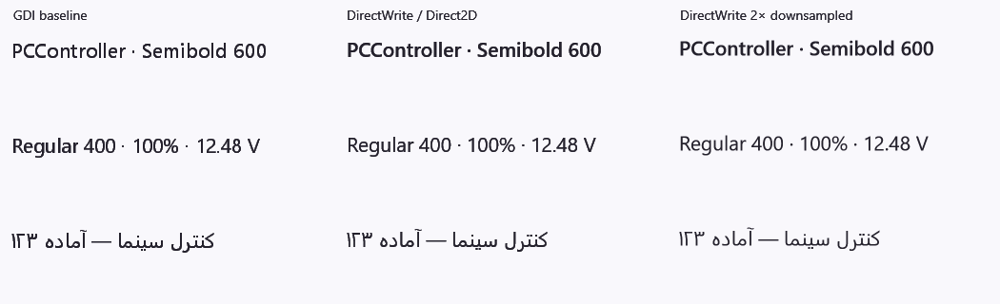
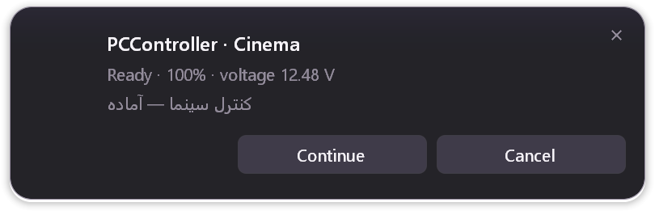
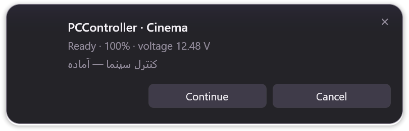

# OSD text rasterizer experiment

Scope: Windows x64 OSD text, not a rewrite of the main GUI or its controls.

## Decision

Keep native DirectWrite layout/shaping plus Direct2D software rasterization as
the default. Keep the original GDI renderer as an automatic whole-card fallback.
Do not keep 2× supersampling/downsampling: its native-size result was softer.
No third-party runtime, bundled font, external helper, or GPU requirement is added.

The improvement is not simply “enable ClearType.” RGB subpixel antialiasing
assumes an opaque background. The OSD fades and moves over solid, transparent,
acrylic and blurred surfaces. Direct2D supplies correct coverage alpha with
grayscale antialiasing, replacing the old GDI black-matte/channel-max extraction.
See Microsoft's [Direct2D/DirectWrite text rendering documentation](https://learn.microsoft.com/en-us/windows/win32/direct2d/direct2d-and-directwrite)
and [DC render target alpha requirements](https://learn.microsoft.com/en-us/windows/win32/api/d2d1/nf-d2d1-id2d1factory-createdcrendertarget).

## Actual native output

These are the real renderer's PNG outputs, not mockups or rescaled screenshots.
The three columns compare GDI, native DirectWrite, and 2× downsampled DirectWrite.
The displayed text and voltage are fixture strings, not hardware measurements.





Whole OSD cards at 144 DPI:





## Verification and cost

- Actual primary-family weights measured as Regular 400 and Semibold 600, not
  inferred from requested format values. Missing Semibold falls back to Regular.
- Fractional font sizes retained. English, Persian/RTL, mixed-direction text,
  CJK, symbols and surrogate-pair emoji exercised at 96, 110, 120, 144, 168,
  192, 240, 288 and 384 DPI. These are offscreen DPI tests, not nine physical monitors.
- Coverage, premultiplied tint, glyph bounds, close-glyph centering, multiline
  layout and marquee remain covered. Oversized surfaces retain the GDI fallback.
- Native target failure retries the entire card in GDI; it does not mix text
  metrics within a presentation. `text_renderer` reports the actual backend.
- The live presenter owns and reuses its target on its locked OS thread, releases
  it there on shutdown, and bounds its DPI/font-format cache to 32 entries.
- No rasterizer calls during 120 cached animation frames. GDI handle growth
  checked across 40 create/draw/close sessions; this is not a claim of a full
  process-memory or driver soak.
- Source-owned live-window tests exercise the real compositor with solid,
  transparent, acrylic and blur backgrounds, plus close/action/hover transitions.
  They do not capture unrelated desktop content or actuate hardware.

Local 144-DPI experiment, 80 preparations per renderer, retained text session:

| CPU operation | GDI median | DirectWrite median |
| --- | ---: | ---: |
| Prepare complete bilingual card | 26.58 ms | 27.75 ms |
| Composite one cached animation frame | 0.79 ms | 0.77 ms |

Cached-frame p95 was 1.27 ms / 0.84 ms respectively; these small differences
are workload/run variation, not a claim that DirectWrite accelerated animation.
The isolated-preview path, including a new text session per card, measured
31.91 ms median / 37.92 ms p95. Initializing the first text session within this
already-running test process took 3.08 ms; that is not a cold process-start measurement.
These are CPU raster/composite timings, not display scanout, physical latency,
or guaranteed frame rates on other machines.

Reproduce from the repository on Windows using the stable-path test runner:

```powershell
$env:GOFLAGS = '-mod=vendor'
$env:PCCONTROLLER_OSD_TEXT_EXPERIMENT = 'C:/absolute/verification/text-run'
$env:PCCONTROLLER_OSD_LIVE = '1'
$env:PCCONTROLLER_OSD_CAPTURE = 'C:/absolute/verification/compositor-run'
node Tools/Build/go-tests.mjs --module Tools/NativeDesktop --package osd --retest
```

The opt-in outputs include native-size comparisons, all DPI/theme cards,
compositor captures and `timings.json`. GDI remains the fallback on Windows
386/ARM64; the new ABI adapter is intentionally restricted to Windows amd64.
Physical multi-monitor movement, other Windows/GPU/RDP environments and the
user's visual acceptance remain distinct gates.
